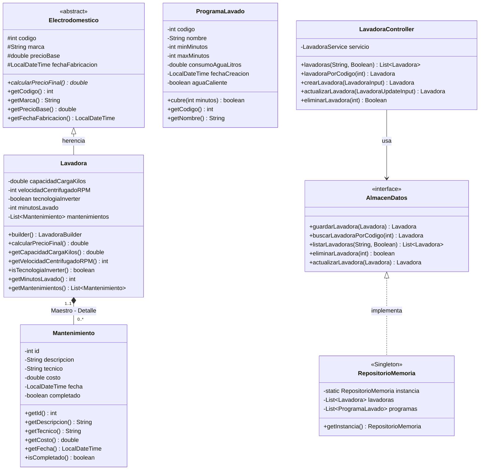

# Voltia - Gestor de Electrodomesticos

Segundo Proyecto 2026B - Diseno de Soluciones - Universidad de Ibague.

Aplicacion distribuida basada en arquitectura de servicios web GraphQL: un servidor central en Java gestiona los datos en memoria y dos clientes de escritorio desacoplados, implementados en tecnologias distintas (C# y Python), consumen los servicios a traves de la red.

| Componente | Tecnologia | Carpeta |
| :--- | :--- | :--- |
| Servidor | Java 17 / 21, Spring Boot 3, Spring GraphQL | `ServidorLavadora` |
| Cliente 1 | C# (.NET Framework 4.8 / .NET 8, WPF en puro codigo C# sin XAML) | `ClienteLavadora` |
| Cliente 2 | Python 3 (Tkinter con diseno modular y asincronia) | `ClientePython` |

## Integrantes del Proyecto

| Nombre | Codigo Estudiantil |
| :--- | :--- |
| Juan Andres Bermeo Alvarez | 2220241053 |
| Alejandro Sanchez Quimbayo | 2220241077 |
| David Arredondo | 2220241062 |

---

## Modelo de Dominio y Diagrama UML de Clases

Para cumplir rigurosamente con la especificacion academica de arquitectura orientada a objetos y la Figura 1 (Maestro - Detalle: 1..1 a 0..*), se identifico y corrigio la premisa inicial donde se asociaba un programa unico por lavadora. En un sistema real de electrodomesticos, la entidad principal es la **Lavadora** (Maestro), la cual dispone de un historial o coleccion dependiente de registros (Detalle: mantenimientos tecnicos o catalogo de programas soportados).



---

## Atributos Requeridos (Cumplimiento de Tipos)

El proyecto cumple con la exigencia de contener mas de 5 atributos con tipos heterogeneos:

| Objeto | Atributos y Tipos |
| :--- | :--- |
| **Electrodomestico** (Abstracta) | `codigo` (int), `marca` (String), `precioBase` (double), `fechaFabricacion` (LocalDateTime). |
| **Lavadora** (Maestro) | Hereda 4 de Electrodomestico + `capacidadCargaKilos` (double), `velocidadCentrifugadoRPM` (int), `tecnologiaInverter` (boolean), `minutosLavado` (int), `mantenimientos` (List). |
| **Mantenimiento** (Detalle) | `id` (int), `descripcion` (String), `tecnico` (String), `costo` (double), `fecha` (LocalDateTime), `completado` (boolean). |
| **ProgramaLavado** | `codigo` (int), `nombre` (String), `minMinutos` (int), `maxMinutos` (int), `consumoAguaLitros` (double), `fechaCreacion` (LocalDateTime), `aguaCaliente` (boolean). |

---

## Patrones de Diseno y Principios SOLID

1. **MVC (Modelo - Vista - Controlador):** Separacion estricta en servidor y clientes. La vista nunca hace peticiones directas de red sin pasar por los controladores o servicios.
2. **Singleton:** Punto unico de almacenamiento en memoria (`RepositorioMemoria`) en el servidor, y cliente HTTP GraphQL compartido en los clientes para optimizar conexiones.
3. **Builder:** Construccion segura de objetos complejos con validaciones paso a paso (`Lavadora.builder()`).
4. **Observer:** Mecanismo reactivo para que la ventana de listado se actualice automaticamente al registrarse mutaciones (altas, bajas o cambios) desde otras ventanas.
5. **SOLID:** Clases con responsabilidad unica (S), abiertas a extension (O), sustitucion de Liskov en la jerarquia de Electrodomestico (L), segregacion de interfaces (I) e inversion de dependencias mediante abstracciones (D).

La explicacion paso a paso orientada a defensa tecnica se encuentra en `DOCUMENTACION.md`.

---

## Guia de Ejecucion

### 1. Servidor Java Spring Boot GraphQL

1. Abrir la carpeta `ServidorLavadora` en IntelliJ IDEA, VS Code o terminal.
2. Ejecutar la aplicacion principal:
   ```bash
   mvn spring-boot:run
   ```
   o ejecutar `ServidorLavadoraApplication.java`.
3. El endpoint GraphQL estara activo en: `http://localhost:8081/graphql`.
4. Para realizar pruebas interactivas en el navegador: `http://localhost:8081/graphiql`.
   Las consultas y mutaciones de ejemplo estan en `pruebas_graphiql_voltia.txt`.

### 2. Cliente 1 en C# (WPF puro en C# sin XAML)

1. Abrir la solucion `ClienteLavadora/ClienteLavadora.slnx` en Visual Studio.
2. Restaurar paquetes NuGet (GraphQL.Client).
3. Compilar y ejecutar con `F5`.
4. La interfaz cuenta con diseno industrial, tambor animado (OjoDeBuey), control de hilos en segundo plano para no congelar la UI y panel de navegacion modular.

### 3. Cliente 2 en Python (Tkinter)

1. Requiere Python 3.9 o superior.
2. Entrar a la carpeta `ClientePython`:
   ```bash
   cd ClientePython
   python main.py
   ```
3. Cuenta con sonido de inicio unico, ventanas modales independientes por caso de uso, validaciones y sincronizacion con el servidor.

---

## Ventanas y Casos de Uso del Sistema

Cumpliendo con la rubrica de calificacion (una ventana independiente por caso de uso):

- **Ventana Principal:** Dashboard con acceso al menu corporativo, indicador de estado de conexion y accesos directos.
- **Ventana Adicionar (20%):** Formulario con validacion exhaustiva de atributos y calculo de precio final.
- **Ventana Consultar (20%):** Busqueda precisa por uno o dos criterios (codigo o marca), cargando el objeto individual.
- **Ventana Actualizar (20%):** Busqueda previa obligatoria, precarga de datos actuales y aplicacion de mutacion en el servidor.
- **Ventana Eliminar (20%):** Busqueda previa obligatoria, presentacion completa de campos y dialogo de confirmacion destructiva.
- **Ventana Listar con Filtro (20%):** Panel de datos con filtrado en servidor y patron Observer para refresco automatico.
- **Ventana Acerca De:** Informacion institucional del curso y datos de los integrantes.
