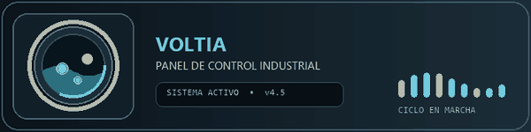
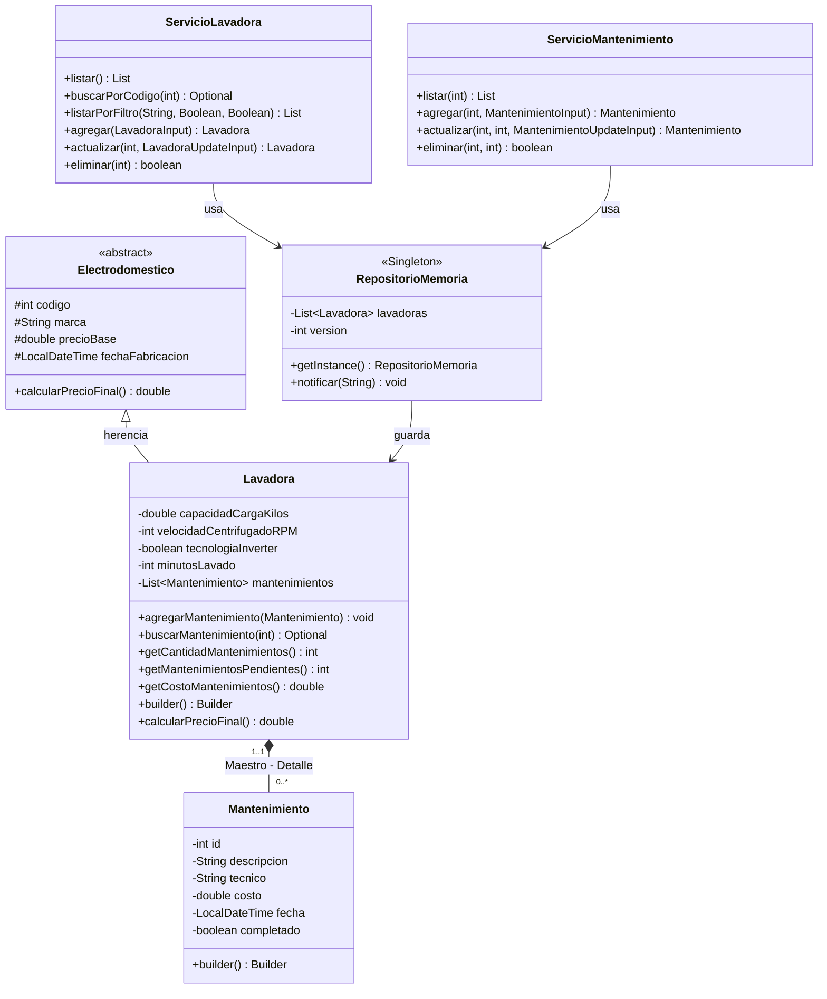

# Voltia - Sistema Distribuido de Lavadoras (Maestro - Detalle)

Segundo Proyecto 2026B - Diseno de Soluciones - Universidad de Ibague.
Version de la aplicacion: **v4.5**.

<p align="center">
  
</p>

<p align="center"><b>Dos clientes, un servidor GraphQL y un tambor que nunca se queda quieto.</b></p>

Aplicacion distribuida cliente-servidor sobre servicios web GraphQL: un servidor central
en Java (Spring Boot) administra los datos en memoria y dos clientes independientes los
consumen por la red, cada uno con su propia tecnologia.

| Componente | Tecnologia | Carpeta |
| :--- | :--- | :--- |
| Servidor | Java 17-21, Spring Boot, Spring GraphQL | `ServidorLavadora` |
| Cliente 1 | C# con WPF en puro codigo C# (sin un solo archivo XAML) | `ClienteLavadora` |
| Cliente 2 | Aplicacion web con framework Express (Node.js + JavaScript) | `ClienteWeb` |

## Integrantes del Proyecto

| Nombre | Codigo Estudiantil |
| :--- | :--- |
| Juan Andres Bermeo Alvarez | 2220241053 |
| Alejandro Sanchez Quimbayo | 2220241077 |
| David Arredondo | 2220241062 |

---

## 1. Que resuelve el sistema

Voltia administra lavadoras industriales y los mantenimientos que se les hacen. Cada
lavadora es un objeto principal que puede tener cero, uno o muchos mantenimientos
asociados. El sistema permite:

- Registrar lavadoras con sus siete datos tecnicos.
- Consultar una lavadora individual por su codigo desde los clientes.
- Listar y filtrar lavadoras en el servidor (por marca, por tecnologia inverter y por
  tenencia de mantenimientos).
- Actualizar y eliminar lavadoras con busqueda previa obligatoria.
- Registrar, actualizar y eliminar los mantenimientos de cada lavadora.

La consulta individual de un mantenimiento requiere el codigo de su lavadora y el id
del mantenimiento. El servidor tambien expone busquedas combinadas para lavadoras; la
interfaz de usuario las busca por codigo. El PDF pide acordar los criterios con el
docente, pero no especifica cuales se acordaron para este proyecto.

---

## 2. Arquitectura general

```text
+-------------------------------+          +-------------------------------+
|  Cliente 1: C# WPF            |          |  Cliente 2: Web (JavaScript)  |
|  Todo en codigo C#, sin XAML  |          |  HTML + CSS + JS sin framework|
|  MVC + Singleton + Builder    |          |  MVC + Singleton + Builder    |
|  + Observer + async/await     |          |  + Observer + async/await     |
+-------------------------------+          +-------------------------------+
                \                                        /
                 \   POST http://localhost:8081/graphql  /
                  \                                    /
                   v                                  v
          +---------------------------------------------------+
          |     Servidor Java Spring Boot (puerto 8081)        |
          |                                                   |
          |  controller/  -> recibe queries y mutations       |
          |  servicios/   -> reglas de negocio y validaciones |
          |  repositorio/ -> RepositorioMemoria (Singleton)   |
          |  model/       -> Lavadora y Mantenimiento         |
          +---------------------------------------------------+
                     datos en memoria (listas concurrentes)
```

Los dos clientes son independientes entre si: se pueden abrir al mismo tiempo y cada uno
ve los cambios que hace el otro gracias a la version de los datos (`versionDatos`).

---

## 3. Modelo de dominio: relacion Maestro - Detalle (Figura 1)

La guia pide una relacion **1..1 a 0..*** y descarta la idea de que una lavadora tiene un
unico programa fijo. En este proyecto:

- **Maestro (1..1): Lavadora.** Es el objeto principal del sistema.
- **Detalle (0..*): Mantenimiento.** Cada lavadora guarda su propia coleccion de
  mantenimientos. Puede tener **cero, uno o muchos**.

La lavadora hereda de `Electrodomestico` (herencia y polimorfismo) y la relacion con sus
mantenimientos es de **composicion**: si se elimina la lavadora, desaparecen sus detalles.



### 3.1 Atributos y tipos (requisito de cinco atributos variados)

| Entidad | Atributos y tipos |
| :--- | :--- |
| `Electrodomestico` (abstracta) | `codigo` (int), `marca` (String), `precioBase` (double), `fechaFabricacion` (LocalDateTime) |
| `Lavadora` (Maestro) | Hereda 4 + `capacidadCargaKilos` (double), `velocidadCentrifugadoRPM` (int), `tecnologiaInverter` (boolean), `minutosLavado` (int) + la lista de mantenimientos |
| `Mantenimiento` (Detalle) | `id` (int), `descripcion` (String), `tecnico` (String), `costo` (double), `fecha` (LocalDateTime), `completado` (boolean) |

Las dos entidades de la relacion superan los cinco atributos y cubren los cinco tipos
pedidos: int, double, String, LocalDateTime y boolean.

### 3.2 Regla de negocio del precio final

`Lavadora.calcularPrecioFinal()` sobrescribe el metodo abstracto de `Electrodomestico`:

- Precio base heredado.
- Si la capacidad de carga supera los 15 kg, se suman 120.000.
- Si la lavadora es inverter, se suman 250.000.

El campo `precioFinal` de GraphQL se llena con ese calculo, no con un dato guardado.

---

## 4. Contrato GraphQL

El contrato completo esta en `ServidorLavadora/src/main/resources/graphql/schema.graphqls`.
Todas las peticiones son un POST a `http://localhost:8081/graphql` con un cuerpo JSON que
lleva la consulta y, opcionalmente, variables.

| Tipo | Operacion | Para que sirve |
| :--- | :--- | :--- |
| Query | `lavadoras` | Lista todas las lavadoras con su detalle |
| Query | `lavadoraPorCodigo(codigo)` | Busca una lavadora por codigo |
| Query | `lavadoraPorCriterios(codigo, marca)` | Busca una lavadora por uno o dos criterios |
| Query | `lavadorasPorFiltro(marca, tecnologiaInverter, conMantenimientos)` | Listado con filtros aplicados en el servidor |
| Query | `mantenimientos(codigoLavadora)` | Detalle de una lavadora |
| Query | `mantenimientoPorId(codigoLavadora, id)` | Un mantenimiento puntual |
| Query | `mantenimientosPorFiltro(codigoLavadora, tecnico, completado)` | Filtros del detalle en el servidor |
| Query | `versionDatos` | Numero que sube cuando un cliente cambia algo |
| Mutation | `addLavadora(input)` | Crea una lavadora (nace con cero mantenimientos) |
| Mutation | `actualizarLavadora(codigo, input)` | Actualiza previa busqueda; solo cambia lo enviado |
| Mutation | `eliminarLavadora(codigo)` | Elimina previa busqueda; borra tambien su detalle |
| Mutation | `addMantenimiento(codigoLavadora, input)` | Agrega un detalle; el id lo calcula el servidor |
| Mutation | `actualizarMantenimiento(codigoLavadora, id, input)` | Actualiza previa busqueda |
| Mutation | `eliminarMantenimiento(codigoLavadora, id)` | Elimina previa busqueda |

Detalles importantes del contrato:

- Las fechas viajan como **texto** `yyyy-MM-ddTHH:mm:ss` porque GraphQL no trae un tipo
  fecha propio. El servidor las formatea y las valida.
- Los filtros se resuelven **en el servidor**, no en el cliente: el cliente solo manda
  parametros y el servidor devuelve lo que corresponde.
- Los errores de negocio (codigo repetido, fecha invalida, lavadora inexistente) llegan
  como errores GraphQL con un mensaje en espanol listo para mostrar al usuario.

---

## 5. Patrones de diseno exigidos

| Patron | Donde esta | Para que se usa |
| :--- | :--- | :--- |
| **MVC** | Servidor: `model` / `controller` / `servicios`. Clientes: `modelo` / `vista` / `controlador` | Separar datos, interfaz y coordinacion de casos de uso |
| **Singleton** | `RepositorioMemoria.getInstance()` en el servidor; `ClienteGraphQL` en los dos clientes | Una sola copia de los datos y una sola conexion HTTP reutilizada |
| **Builder** | `Lavadora.builder()`, `Mantenimiento.builder()` en Java; `ConstructorLavadora`, `ConstructorMantenimiento` en los clientes | Armar objetos de muchos atributos paso a paso sin constructores enormes |
| **Observer** | `ObservadorRepositorio` + `RegistroCambios` en el servidor; `NotificadorDatos` + vigilante de `versionDatos` en los clientes | Refrescar la grilla sola cuando cambian los datos, incluso si el cambio lo hizo el otro cliente |
| **SOLID** | Ver la seccion 6 | Codigo mantenible y facil de explicar |

### 5.1 MVC en el servidor

- **Modelo:** `Electrodomestico`, `Lavadora`, `Mantenimiento` y los `Input` de GraphQL.
- **Vista:** el contrato `schema.graphqls` y GraphiQL (la pagina de pruebas).
- **Controlador:** `LavadoraController` y `MantenimientoController` (mapean queries y
  mutations).
- **Servicios:** `ServicioLavadora` y `ServicioMantenimiento` aplican las reglas.
- **Repositorio:** `RepositorioMemoria` guarda los datos.

### 5.2 MVC en los clientes

Las ventanas nunca conocen GraphQL ni construyen consultas: solo llaman al controlador.
El controlador valida, llama al servicio, recibe el resultado y avisa a la vista por el
observador. El servicio es el unico que sabe de la red.

### 5.3 Singleton del cliente GraphQL

```csharp
public static class ClienteGraphQL
{
    private static GraphQLHttpClient cliente;
    private static GraphQLHttpClient Cliente
    {
        get
        {
            if (cliente == null)
            {
                cliente = new GraphQLHttpClient(UrlServidor, new SystemTextJsonSerializer());
            }
            return cliente;
        }
    }
}
```

### 5.4 Builder en Java

```java
Lavadora lavadora = Lavadora.builder()
    .codigo(101)
    .marca("LG")
    .precioBase(1450000)
    .fechaFabricacion(LocalDateTime.of(2024, 3, 10, 9, 0))
    .capacidadCargaKilos(18.0)
    .velocidadCentrifugadoRPM(1400)
    .tecnologiaInverter(true)
    .minutosLavado(45)
    .build();
```

### 5.5 Observer entre los dos clientes

El servidor sube en 1 el contador `versionDatos` cada vez que se crea, actualiza o elimina
algo. Cada cliente consulta ese numero cada pocos segundos: si cambio, vuelve a pedir la
lista sin que el usuario presione nada. Asi, una lavadora agregada en el cliente web
aparece sola en el cliente de escritorio (y al contrario). Dentro de cada cliente tambien
hay un observador interno (`NotificadorDatos`) que refresca la grilla cuando la misma
ventana hace un cambio.

---

## 6. Principios SOLID aplicados

| Principio | Como se aplica | Archivo de ejemplo |
| :--- | :--- | :--- |
| **S** - Responsabilidad unica | Cada clase tiene un solo motivo para cambiar: validar, guardar, mapear, dibujar | `Validaciones`, `RepositorioMemoria`, `LavadoraController` |
| **O** - Abierto / cerrado | Se pueden agregar otros electrodomesticos heredando de `Electrodomestico` sin tocar lo existente | `Electrodomestico`, `Lavadora` |
| **L** - Sustitucion de Liskov | Una `Lavadora` se usa como `Electrodomestico` y su `calcularPrecioFinal()` respeta el contrato | `Lavadora.calcularPrecioFinal()` |
| **I** - Segregacion de interfaces | Interfaces pequenas y por caso de uso | `AlmacenDatos`, `ObservadorRepositorio`, `IServicioLavadoras`, `IServicioMantenimientos` |
| **D** - Inversion de dependencias | Los servicios dependen de `AlmacenDatos`, no de la clase concreta; los controladores de los clientes dependen de interfaces de servicio | `ServicioLavadora`, `ControladorLavadoras` |

---

## 7. Concurrencia e hilos

### 7.1 Servidor

- `RepositorioMemoria` guarda las lavadoras en una `CopyOnWriteArrayList` y los
  mantenimientos de cada lavadora en otra lista concurrente.
- Las operaciones que modifican datos se hacen dentro de `synchronized (candado)`, asi
  dos clientes no pisan la misma lavadora al mismo tiempo.
- Probado con 40 mutaciones simultaneas: se crearon las 40 lavadoras sin errores y sin
  perder datos.
- El observador `RegistroCambios` y el contador `versionDatos` usan estructuras seguras
  para varios hilos (`CopyOnWriteArrayList` y `AtomicInteger`).

### 7.2 Cliente C#

- Cada peticion de red se lanza con `async` / `await` sobre `Task.Run`, de modo que el
  hilo de la interfaz queda libre y el tambor sigue girando.
- La interfaz se actualiza con `Dispatcher.Invoke` cuando el aviso llega desde otro hilo.
- Mientras hay peticiones en curso, el tambor gira mas rapido y el display muestra
  `PROCESANDO`.

### 7.3 Cliente web

- JavaScript es de un solo hilo, pero `fetch` con `async` / `await` no bloquea: mientras
  llega la respuesta, la animacion CSS del tambor sigue corriendo a 60 cuadros por
  segundo.
- El controlador activa el estado `trabajando`, la vista acelera el tambor y, al terminar
  la promesa, lo devuelve a la velocidad normal.

---

## 8. Diseno visual

Los dos clientes comparten la misma metafora: una **lavadora industrial moderna**.

- **Compuerta circular frontal:** aro metalico con gradiente plata, vidrio con gradiente
  radial oscuro, agua y ropa que giran siempre; durante las operaciones de red el tambor
  acelera.
- **Panel superior de control:** pantalla digital (fuente monoespaciada, color cian) con
  el estado y la version de los datos, y botones claros con etiquetas en espanol.
- **Panel de cristal tecnologico (glassmorphism tenue):** fondo semitransparente oscuro,
  borde claro muy fino, esquinas redondeadas y desenfoque de fondo. El contraste es
  limpio y legible: no se usan colores chillones.
- **Paleta:** fondo `#0B1016` a `#111A22`, chasis `#1A242D`, acero `#22303B`, cristal
  `rgba(255,255,255,0.06)` con borde `rgba(255,255,255,0.14)`, acento cian `#6FD3E8`,
  acento ambar `#E8B15A`, texto `#E6EDF3`, secundario `#9FB0BF`.
- En C# no existe ningun archivo `.xaml`: la compuerta, el chasis, los botones y la grilla
  se dibujan con `System.Windows.Shapes`, pinceles y animaciones creadas en codigo.

---

## 9. Estructura del repositorio

```text
POCVoltiaV4/
├── ServidorLavadora/                  Servidor Java Spring Boot GraphQL
│   ├── src/main/java/com/example/ServidorLavadora/
│   │   ├── model/                     Electrodomestico, Lavadora, Mantenimiento e inputs
│   │   ├── repositorio/               AlmacenDatos, RepositorioMemoria (Singleton), observadores
│   │   ├── servicios/                 Reglas de negocio de lavadoras y mantenimientos
│   │   ├── controller/                Controladores GraphQL y manejo de errores
│   │   ├── config/                    Configuracion de Spring
│   │   └── util/                      Validaciones y formatos
│   ├── src/main/resources/graphql/    schema.graphqls (el contrato)
│   └── src/test/                      Pruebas del dominio y del contexto
├── ClienteLavadora/                   Cliente de escritorio en C# (WPF sin XAML)
│   └── ClienteLavadora/
│       ├── modelo/                    Datos, entradas y constructores (Builder)
│       ├── servicios/                 ClienteGraphQL (Singleton) e interfaces
│       ├── controlador/               Casos de uso y vigilante de la version
│       ├── vista/                     Ventanas armadas en codigo C#
│       └── util/                      Tema, componentes, animaciones y observador
├── ClienteWeb/                        Cliente web en JavaScript puro
│   ├── index.html
│   ├── css/estilos.css
│   ├── js/                            modelo, servicios, controlador, vista y observador
│   └── servidor.js                    Servidor estatico local con Express
├── pruebas_graphiql_voltia.txt        Consultas y mutaciones listas para GraphiQL
└── README.md
```

La documentacion interna del equipo se conserva localmente y no se publica en este
repositorio.

## Consulta individual (requisito 5 de la guia)

El requisito 5 solicita consultar un objeto individual por criterios de busqueda
acordados con el docente. La lavadora se consulta por codigo y el mantenimiento por el
par codigo de lavadora + id. El PDF no especifica cuales criterios se acordaron para
este caso; esa parte debe validarse con el docente.

---

## 10. Guia de ejecucion

### Requisitos

- Java 17 o superior (probado con JDK 21).
- Node.js (solo para servir el cliente web; el cliente tambien se puede abrir como archivo).
- Para el cliente C#: Visual Studio 2022 o el SDK de .NET (el proyecto apunta a
  .NET Framework 4.8).

### 1. Servidor Java (desde IntelliJ o consola)

- **Desde IntelliJ IDEA:**
  1. Abrir la carpeta `ServidorLavadora`.
  2. Abrir el archivo `ServidorLavadoraApplication.java`.
  3. Clic derecho y seleccionar `Run 'ServidorLavadoraApplication'`.
- **Desde terminal:**
  ```bash
  cd ServidorLavadora
  mvnw.cmd spring-boot:run        # Windows
  ./mvnw spring-boot:run          # Linux o macOS
  ```

- Servicio GraphQL activo en: `http://localhost:8081/graphql`
- Pruebas interactivas en: `http://localhost:8081/graphiql`
- Las consultas de ejemplo estan en `pruebas_graphiql_voltia.txt`.

### 2. Cliente C# de escritorio (desde Visual Studio)

- **Desde Visual Studio:**
  1. Abrir la solucion `ClienteLavadora/ClienteLavadora.slnx`.
  2. Presionar `F5` o el boton verde `Iniciar`.
  3. La direccion del servidor se configura en `App.config` (clave `UrlServidor`).

- **Desde terminal con dotnet:**
  ```bash
  dotnet run --project ClienteLavadora/ClienteLavadora/ClienteLavadora.csproj
  ```

### 3. Cliente Web con Framework Express (Node.js)

El cliente web esta construido sobre el framework Express (Node.js).

- **Desde terminal (o terminal integrada de Visual Studio en Ver -> Terminal):**
  ```bash
  cd ClienteWeb
  npm start
  ```
  Luego abrir en el navegador: `http://localhost:5501`.

- **Opcion alternativa:**
  Tambien se puede hacer doble clic en `ClienteWeb/index.html` para abrirlo directamente en el navegador. El servidor Java tiene CORS habilitado y funcionara de forma directa.

---

## 11. Pruebas

```bash
cd ServidorLavadora
mvnw.cmd test
```

Las pruebas cubren:

- El Builder y el calculo del precio final.
- La cardinalidad 0..* (cero, uno y varios mantenimientos en una lavadora).
- Las validaciones de datos.
- El Singleton del repositorio.
- El arranque completo del contexto de Spring con el esquema GraphQL.

Ademas, `pruebas_graphiql_voltia.txt` trae un flujo guiado con consultas, mutaciones y
casos de error para demostrar el sistema en GraphiQL.

---

## 12. Ventanas, casos de uso y porcentajes de la rubrica

| Caso de uso | Ventana en C# | Vista en el cliente web | Porcentaje |
| :--- | :--- | :--- | :--- |
| Adicionar | `VentanaAgregar` | Modal "Agregar lavadora" | 20% |
| Consultar | `VentanaConsultar` | Modal "Consultar" | 20% |
| Actualizar | `VentanaActualizar` | Modal "Actualizar" (con busqueda previa) | 20% |
| Eliminar | `VentanaEliminar` | Modal "Eliminar" (con busqueda y confirmacion) | 20% |
| Listar con filtro | `VentanaListar` | Panel principal con filtros y detalle | 20% |
| Mantenimientos (detalle) | `VentanaMantenimientos` | Modal "Mantenimientos" | Complementario |
| Acerca de | `VentanaAcercaDe` | Pie de pagina con la informacion del curso | Complementario |

Cada caso de uso tiene su propia ventana independiente en C# y su propio modal en la web.
Los dos clientes muestran el estado de conexion y avisan con mensajes claros cuando el
servidor rechaza una operacion.
